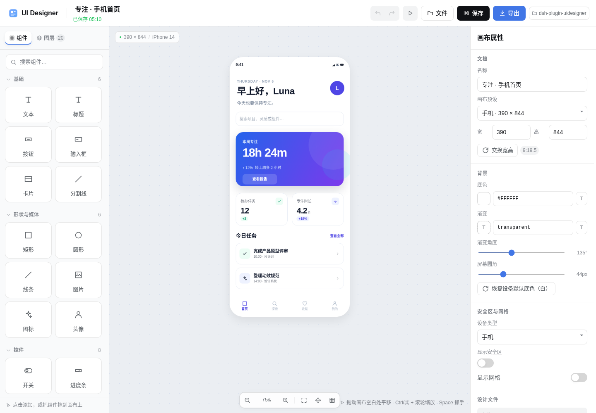
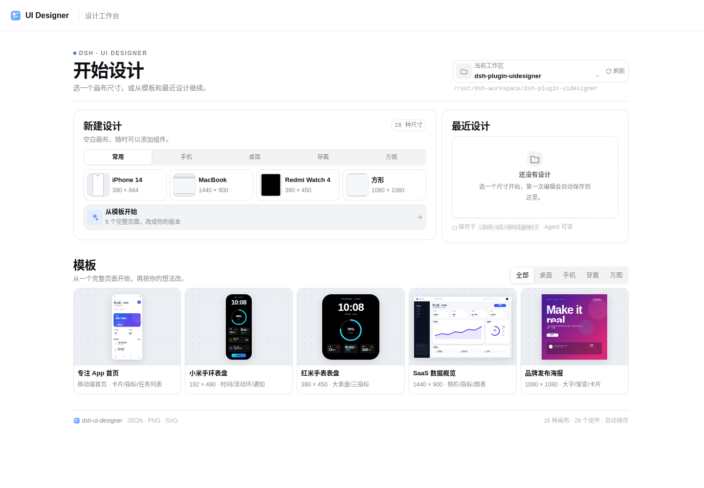
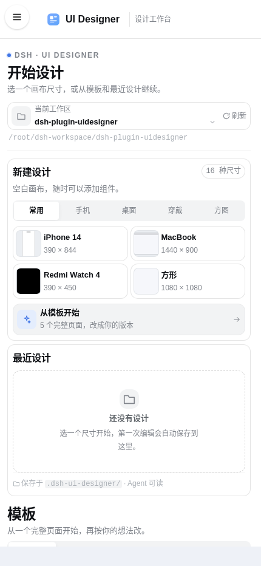
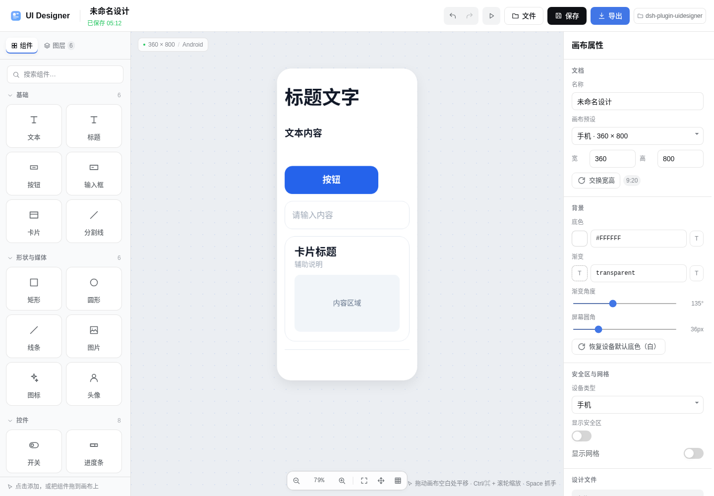
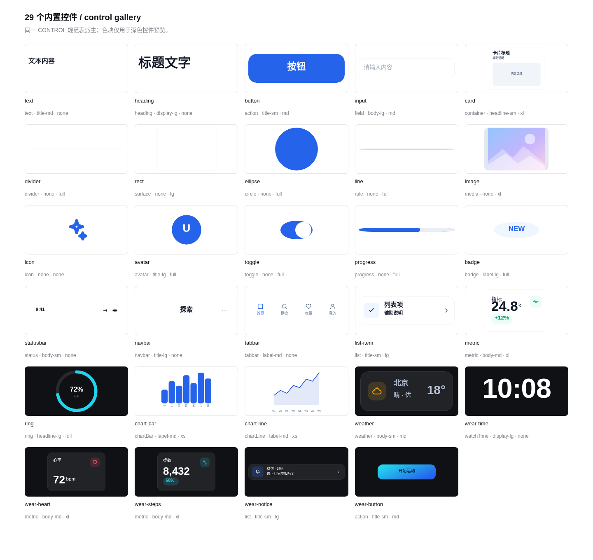
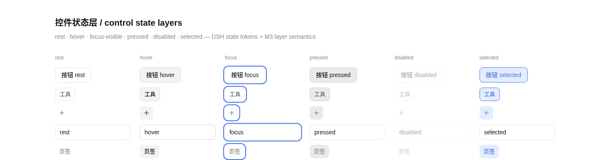

# dsh-ui-designer

[简体中文](README.md) · **English**

A Figma / Canva-like visual UI designer that opens inside DSH Web. It is not a
static screenshot tool: the canvas zooms and pans, layers drag, resize, rotate,
align, lock and hide, and the inspector on the right edits text, colors,
gradients, radii, shadows and component data. It is fully editable on desktop
and on a phone.

Designs are saved as plain JSON files in the selected workspace:

```text
<workspace>/.dsh-ui-designer/<name>-<short-id>.json
<workspace>/.dsh-ui-designer/exports/<name>.png
<workspace>/.dsh-ui-designer/exports/<name>.svg
```

JSON is the single source of truth, so **an agent can read / grep / edit a
design directly** without opening a browser.



<p align="center"> </p>







## Features

- **Canvas**: 16 presets covering desktop 16:9 / 16:10, phone 9:19.5 / 9:20,
  tablet 3:4, 1:1, 4:5, 9:16, plus Xiaomi Band and Redmi Watch screens.
- **Home screen**: create, recent designs and templates on the first screen;
  size filters for common / phone / desktop / wearable / square, searchable
  recent designs, filterable templates, single column on narrow screens.
- **Wearable screens**
  - Xiaomi Band 8 / 9: 192 × 490
  - Xiaomi Band Pro: 336 × 480 (black by default, safe area applied after
    viewing / selecting)
  - Redmi Watch 4: 390 × 450
  - Redmi Watch 5: 432 × 514
  - The safe area is toggleable and editable per edge; exports are clipped to
    the device corner radius.
- **Device default backgrounds**: new phone canvases are white, new wearable
  canvases are black. Both stay editable, with a one-click reset.
- **29 built-in components**: text, heading, button, input, card, divider,
  rectangle, circle, line, image, icon, avatar, switch, progress, badge, status
  bar, nav bar, tab bar, list item, metric card, ring progress, bar chart, line
  chart, weather, watch time, heart rate, steps, notification, wearable quick
  button.
- **Single control spec (Material 3 structure)**: all 29 components derive from
  `CONTROL`; a component definition only declares role / size keys, never font
  size, padding or radius. Type scale display / headline / title / body / label,
  shape none–full, state layers and elevation map one-to-one onto DSH tokens.
  See [`docs/design-tokens.md`](docs/design-tokens.md) for the per-control table.
- **Neutral basics**: single-color accent button with no gradient or shadow,
  card with no icon or shadow, input without a default search icon, text and
  heading with neutral copy, one blue accent across all basics.
- **Full DSH design tokens**: colors, fonts, radii, shadows, focus ring and
  scrollbars all come from DSH theme tokens; light and dark follow the host.
- **Top-left safe area**: reads `--dsh-frame-top-clearance`,
  `--dsh-frame-leading-clearance` and `--dsh-windows-menu-start` from the DSH
  window chrome, and keeps an extra 64px (`--uid-mobile-leading`) in compact
  mode when the host variables are absent, so tool buttons are never covered by
  the hamburger menu at any panel width.
- **Full editing**
  - drag or click to add components
  - multi-select, marquee select, drag, eight-way resize, rotate (Shift snaps
    to 15°)
  - edge / center snapping guides, optional grid snapping
  - layer reorder, show/hide, lock, duplicate, delete, bring to front / send to
    back
  - align, distribute horizontally / vertically
  - undo / redo (50 steps)
  - double-click in-place text editing
  - canvas zoom / pan, fit to canvas, hand tool
  - PNG / SVG export, optional transparent background, PNG at 1× / 2× / 3×
- **Responsive**: three columns on wide screens; narrow screens collapse to the
  canvas plus a bottom toolbar, with components, layers and inspector as
  dismissible drawers; pinch to zoom, drag with one finger.
- **Font size follows geometry on mobile**: resizing text on a phone canvas
  scales the font size proportionally (clamped to 6–400px).
- **Persistence**: autosave about 1.5s after an edit, `⌘S` / `Ctrl+S` to save
  immediately, and a warning before closing the page with unsaved changes.
- **Workspace switching**: from the top bar, the file dialog, or the home
  screen.

## Install

Clone the repository anywhere:

```sh
git clone https://github.com/EstimateFaster/dsh-uidesigner.git
```

Inside DSH Web:

```text
plugin_manager install_bundle /path/to/dsh-plugin-uidesigner
```

Or use *Install bundle* on the plugins page and point it at the cloned
directory (a local `link:` install).

Or from the CLI:

```sh
dsh plugin --profile web add link:/path/to/dsh-plugin-uidesigner
```

**Restart `dsh web` once after installing**: the host half (the RPC storage
service and the bundle patch) loads at startup. After the restart the global
sidebar shows a **UI Designer** icon; open it to start.

> Installing / enabling a plugin only edits the profile file while `dsh web` is
> running. Do not restart a live `dsh web` just to verify a plugin unless you
> have saved your sessions.

> When developing, edit `src/client/*.js` and run `npm run build` to regenerate
> `lib/client.js`. An already-loaded browser bundle only picks up a rebuild
> after a page refresh.

## Usage

1. Open **UI Designer** in the left sidebar.
2. Start from a curated template, or pick a ratio / device screen in *Blank
   canvas*.
3. Click or drag components from the library; drag, resize and rotate them on
   the canvas.
4. Use the inspector to adjust position, size, color, gradient, radius, shadow
   and component content.
5. Click **Save** or wait for autosave; files land in the workspace
   `.dsh-ui-designer/` directory.
6. Use **Export** to write PNG / SVG to the workspace or download it directly.

### Shortcuts

| Shortcut | Action |
| --- | --- |
| `⌘/Ctrl + S` | Save now |
| `⌘/Ctrl + Z` | Undo |
| `⇧⌘/Ctrl + Z` or `Ctrl+Y` | Redo |
| `⌘/Ctrl + D` | Duplicate selection |
| `⌘/Ctrl + A` | Select all |
| `Delete` / `Backspace` | Delete selection |
| Arrow keys / `Shift + Arrow` | Move 1px / 10px |
| `[` / `]` | Send backward / bring forward |
| `Space` + drag | Pan with the hand tool |
| `Ctrl/⌘ + wheel` | Zoom around the pointer |
| `0` | Fit to canvas |
| `+` / `-` | Zoom in / out |
| `P` | Preview |
| `G` | Toggle grid |
| `Esc` | Exit preview / close dialog / clear selection |

## Design JSON

See [`examples/xiaomi-band-watchface.json`](examples/xiaomi-band-watchface.json)
and [`examples/phone-home.json`](examples/phone-home.json); the full field
reference and agent instructions are in
[`docs/design-format.md`](docs/design-format.md) (Chinese).

A minimal document:

```json
{
  "kind": "dsh-ui-designer",
  "version": 1,
  "id": "uid_ab12cd34ef56",
  "title": "My watchface",
  "canvas": {
    "presetId": "mi-band",
    "width": 192,
    "height": 490,
    "background": "#05070C",
    "background2": "#101A2E",
    "gradientAngle": 160,
    "radius": 48,
    "deviceType": "wearable",
    "safeArea": { "top": 34, "bottom": 28, "left": 10, "right": 10 },
    "showSafeArea": false,
    "showGrid": false,
    "gridSize": 8
  },
  "nodes": [
    {
      "id": "n_time",
      "type": "text",
      "name": "Time",
      "x": 12,
      "y": 40,
      "w": 168,
      "h": 58,
      "text": "10:08",
      "color": "#FFFFFF",
      "fontSize": 47,
      "fontWeight": 700,
      "align": "center",
      "valign": "middle"
    }
  ],
  "createdAt": "2026-01-01T00:00:00.000Z",
  "updatedAt": "2026-01-01T00:00:00.000Z"
}
```

An agent can then do things like:

```text
Read <workspace>/.dsh-ui-designer/my-watchface-xxxx.json, set the heart-rate
node value to 78, add a weather node, save, and report back.
```

## Export

- **SVG**: a plain `<svg>` with no `foreignObject`; text stays real text and
  images are embedded as data URLs. Opens in browsers, Figma and Illustrator.
- **PNG**: rasterized in the browser from the same SVG at 1× / 2× / 3×; above
  roughly 28 megapixels it is automatically reduced to a safe size.
- Device canvases are clipped to `canvas.radius`, transparent outside the
  rounded corners; the transparent background option drops the canvas fill.

## Layout

| Path | Contents |
| --- | --- |
| `lib/index.js` | Host half: authenticated `/api/ui-designer` RPC route, workspace listing, JSON read/write, PNG/SVG persistence |
| `lib/client.js` | Browser bundle, generated by `build.mjs` from `src/client/*.js` |
| `src/client/` | Editor source: renderer, component catalog, inspector, canvas interaction, exporter, styles |
| `cordis.patch.yml` | Inserts the host plugin row |
| `docs/design-format.md` | JSON structure, node types, agent usage |
| `docs/design-tokens.md` | DSH token sources, mapping tables, control roles, M3 comparison, gaps |
| `examples/` | Ready-to-open example designs |
| `test/` | Host RPC tests and a browser harness |

## Development

```sh
node build.mjs                  # regenerate lib/client.js and syntax-check it
node --test test/host.test.mjs  # host RPC, path safety, read/write/delete, PNG header
```

Browser harness:

```sh
google-chrome --headless=new --no-sandbox --allow-file-access-from-files \
  --window-size=1440,1000 test/harness.html
```

It drives the full flow with mocked RPC (home → template → select / drag /
resize / rotate → component library → autosave → SVG/PNG export → preview) and
writes the results into the `results` block at the bottom of the page.

Optional `?stage=` variants: `homecheck`, `start`, `layout`, `tokens`,
`presetcheck`, `fontlink`, `spec`, `controlspec`, `gallery`, `states`.

`test/vendor/dsh-theme-tokens.css` is a read-only test copy of the DSH theme
tokens; it exists only so the standalone harness sees the same CSS variables as
the DSH host. The plugin does not depend on it.

## Known limitations

- No multiplayer or cloud sharing; the JSON file is the sharing unit.
- No arbitrary boolean paths, masks, auto layout or component instances;
  cards, charts and watchfaces are parameterized components.
- Images are inlined as data URLs, so design JSON grows with them; the host
  caps a single file at 12MB.
- Exported PNGs are rasterized with browser fonts, so font metrics can differ
  across systems.
- Switching workspaces saves the current design before returning to the home
  screen.
- If an agent edits a design's JSON on disk while it is open in the designer,
  reopen it from the file dialog to pick up the change; editing an unsaved
  designer state afterwards can overwrite the disk version.

## License

MIT. Third-party notices are in
[`THIRD-PARTY-NOTICES.md`](THIRD-PARTY-NOTICES.md).
