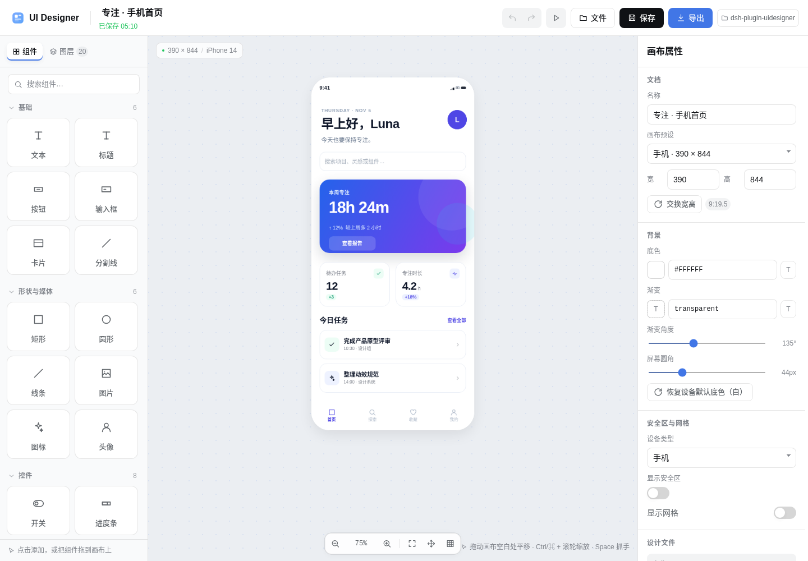
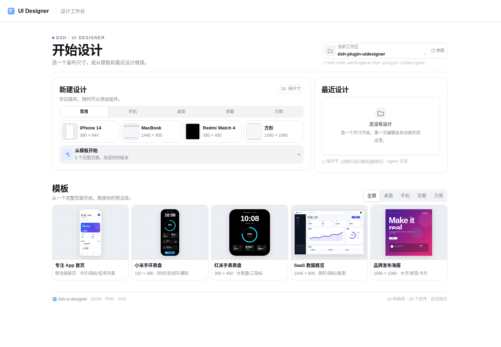
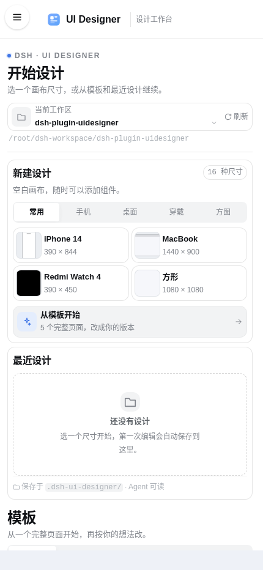
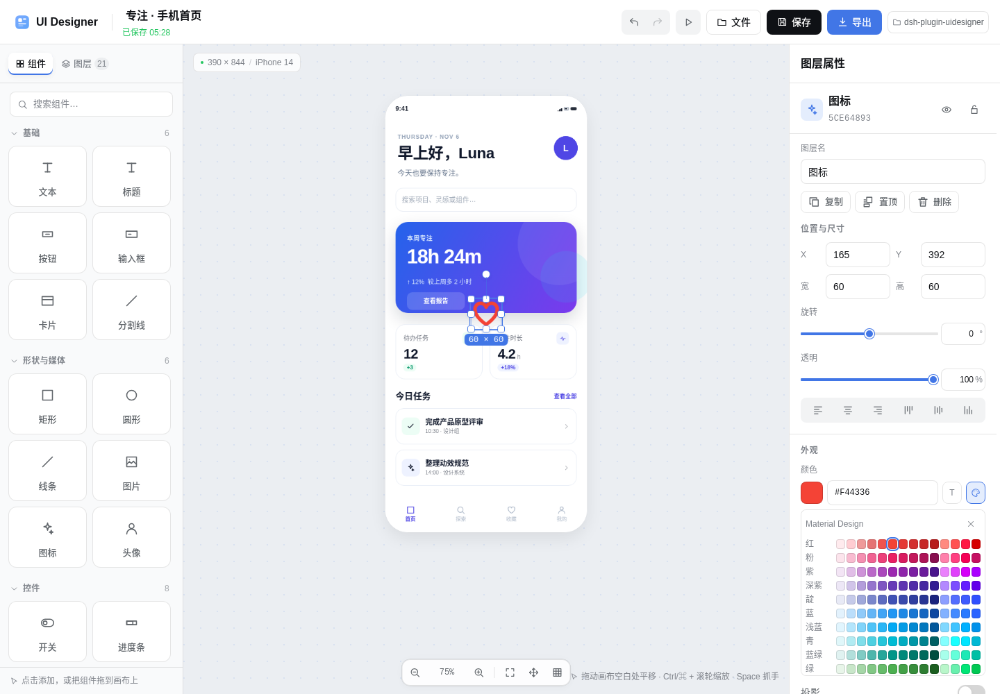
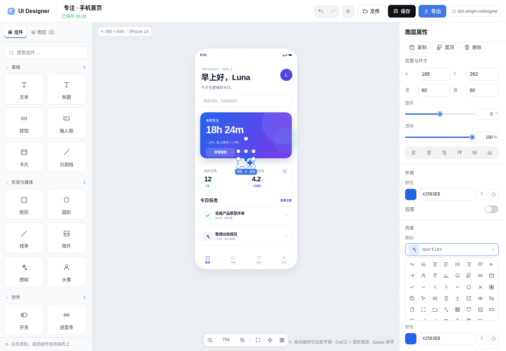
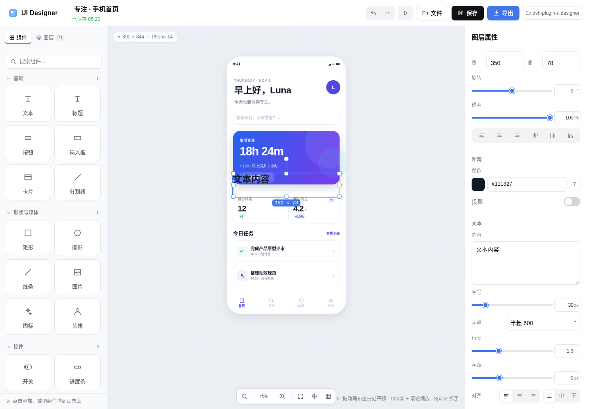
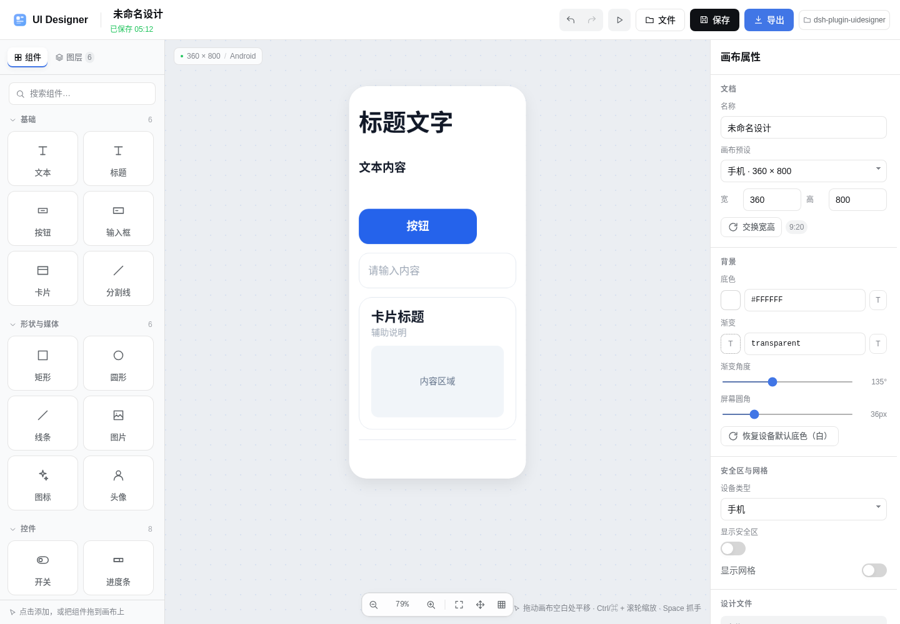
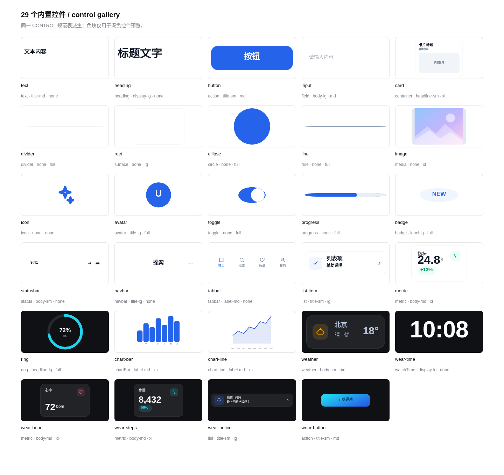
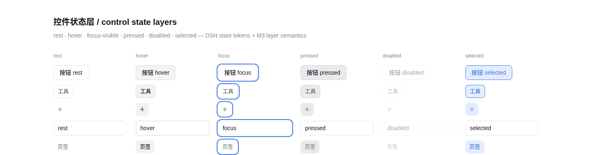

# dsh-ui-designer

**简体中文** · [English](README.en.md)

在 DSH Web 里直接开一个类似 Figma / Canva 的可视化 UI 设计器。它不是一张静态截图工具：画布可缩放/平移，图层可拖拽、缩放、旋转、对齐、锁定、隐藏，右侧属性面板能改文字、颜色、渐变、圆角、阴影和组件数据；桌面和手机都能完整编辑。

设计稿会保存成所选工作区里的普通 JSON 文件：

```text
<workspace>/.dsh-ui-designer/<设计名>-<短 id>.json
<workspace>/.dsh-ui-designer/exports/<设计名>.png
<workspace>/.dsh-ui-designer/exports/<设计名>.svg
```

JSON 是唯一数据源，**Agent 可以直接 read / grep / 编辑它**，不需要打开浏览器。



<p align="center"> </p>













## 功能

- **画布**：16 种预设，覆盖桌面 16:9 / 16:10、手机 9:19.5 / 9:20、平板 3:4、1:1、4:5、9:16，以及小米手环和红米手表屏。
- **工作台首页**：新建画布、最近设计与模板三条入口放在首屏；尺寸按常用 / 手机 / 桌面 / 穿戴 / 方图切换，最近设计可搜索，模板可筛选，窄屏自动收敛为单列。
- **穿戴设备屏**
  - 小米手环 8 / 9：192 × 490
  - 小米手环 Pro：336 × 480（默认黑底，查看/选中后按穿戴安全区处理）
  - Redmi Watch 4：390 × 450
  - Redmi Watch 5：432 × 514
  - 安全区可开关、可逐边调整；导出时自动裁成设备圆角。
- **设备默认背景**：新建手机画布为白底，新建穿戴画布为黑底；属性面板仍可任意改色，并可一键恢复设备默认底色。
- **29 个内置组件**：文本、标题、按钮、输入框、卡片、分割线、矩形、圆形、线条、图片、图标、头像、开关、进度条、徽章、状态栏、导航栏、标签栏、列表项、指标卡、环形进度、柱状图、折线图、天气、表盘时间、心率、步数、通知、穿戴快捷按钮。
- **单一控件规范（对齐 Material 3 结构）**：29 个组件全部从 `CONTROL` 派生，组件定义只声明角色/尺寸键，不写字号、内边距、圆角。类型层级 display / headline / title / body / label、形状 none–full、state layer、elevation 与 DSH token 一一对应；逐控件映射表、例外与缺口见 [`docs/design-tokens.md#6-画布内置控件规范单一-control-表对齐-m3`](docs/design-tokens.md#6-画布内置控件规范单一-control-表对齐-m3)。
- **基础组件中性默认**：button 单色 accent、无渐变/投影；card 无图标/投影、带内容占位；input 无默认搜索图标；text/heading 使用中性文案；所有基础 accent 统一到同一蓝系。组件库图标不再加彩色贴片。
- **全量 DSH 设计 token**：颜色、字体、圆角、阴影、焦点环、滚动条全部接入 DSH 主题；深色/浅色自动跟随。映射表、缺口与残留项见 [`docs/design-tokens.md`](docs/design-tokens.md)。
- **全局 Material Design 调色盘**：20 个色族 / 266 个 MD 色阶（含中性色），任何 `ColorInput`（画布底色、渐变、填充、描边、文字、图标、组件 accent）都可打开；原生取色器和文本输入仍保留。
- **图标颜色与候选**：修复图标颜色切换不生效；图标选择从下拉改为 81 个可视化候选网格，选中项有高亮。
- **字号调节**：字号用「滑块 + 数字输入」双通道，数字输入可直接键入精确值；字号下限 1px，不再截断到 6px。行高、字距、透明度、圆角、描边、进度等参数同样支持滑块 + 数字输入。
- **左上角安全区**：读取 DSH 窗口 chrome 发布的 `--dsh-frame-top-clearance` / `--dsh-frame-leading-clearance` / `--dsh-windows-menu-start`；Web/移动端 DSH 汉堡菜单没有宿主变量时，compact 模式额外保留 64px（`--uid-mobile-leading`），任何面板宽度下工具入口都不会被菜单按钮遮挡。
- **完整编辑**
  - 拖入 / 点击添加组件
  - 多选、框选、拖拽移动、八向缩放、旋转（Shift 吸附 15°）
  - 边缘/中心吸附参考线、可选网格吸附
  - 图层重排、显隐、锁定、复制、删除、置顶/置底
  - 对齐、水平/垂直分布
  - 撤销/重做（50 步）
  - 双击文本原地编辑
  - 画布缩放/平移、适配画布、抓手模式
  - PNG / SVG 导出，透明背景可选，PNG 支持 1× / 2× / 3×
- **响应式**：宽屏三栏；窄屏自动收敛为画布 + 底部工具条，组件、图层、属性都是可关闭的抽屉；双指缩放，单指拖动图层。
- **手机端字号联动**：在手机画布上拖拽缩放文本类控件时，字号随控件尺寸等比变化（1–400px 极值保护），不会出现固定字号被裁切。
- **持久化**：编辑后约 1.5 秒自动保存；`⌘S` / `Ctrl+S` 立即保存；页面关闭前会提示未保存内容。
- **工作区切换**：顶部 / 文件弹窗 / 首页都可以切换保存到哪个工作区。

## 安装

先克隆仓库到本地任意目录：

```sh
git clone https://github.com/EstimateFaster/dsh-uidesigner.git
```

在 DSH Web 里：

```text
plugin_manager install_bundle /path/to/dsh-plugin-uidesigner
```

或者用插件页的「安装组合包」，目标填克隆下来的目录（本地 `link:` 安装）。

也可以直接用 CLI：

```sh
dsh plugin --profile web add link:/path/to/dsh-plugin-uidesigner
```

安装后**重启一次 `dsh web`**：宿主半侧（RPC 存储服务和组合包 patch）是启动时加载的。重启后左侧全局面板会出现 **UI 设计器** / **UI Designer** 图标，点开即可。

> 当前工作区的 `dsh web` 正在运行时，安装/启停插件只改 profile 文件；不要为了验证插件重启它，除非你已经保存好会话。

> 开发时改 `src/client/*.js` 后运行 `npm run build` 重新生成 `lib/client.js`。已经加载的浏览器 bundle 刷新页面才会替换；不要为了测试重启正在使用的 `dsh web`，除非你已经保存好会话。

## 使用

1. 打开左侧「UI 设计器」。
2. 从精选模板开始，或在「空白画布」里选一个比例 / 设备屏。
3. 从左侧组件库点击或拖入组件；在画布上拖动、缩放、旋转。
4. 右侧属性面板调整位置、尺寸、颜色、渐变、圆角、阴影和组件内容。
5. 顶部「保存」或等待自动保存；文件会出现在工作区 `.dsh-ui-designer/`。
6. 顶部「导出」选择 PNG / SVG，可保存到工作区或直接下载。

### 快捷键

| 快捷键 | 作用 |
| --- | --- |
| `⌘/Ctrl + S` | 立即保存 |
| `⌘/Ctrl + Z` | 撤销 |
| `⇧⌘/Ctrl + Z` 或 `Ctrl+Y` | 重做 |
| `⌘/Ctrl + D` | 复制选中图层 |
| `⌘/Ctrl + A` | 全选 |
| `Delete` / `Backspace` | 删除选中 |
| 方向键 / `Shift + 方向键` | 移动 1px / 10px |
| `[` / `]` | 下移 / 上移一层 |
| `Space` + 拖拽 | 抓手平移 |
| `Ctrl/⌘ + 滚轮` | 以指针为中心缩放 |
| `0` | 适应画布 |
| `+` / `-` | 放大 / 缩小 |
| `P` | 预览 |
| `G` | 显示/隐藏网格 |
| `Esc` | 退出预览 / 关闭弹窗 / 取消选择 |

## 设计 JSON

示例见 [`examples/xiaomi-band-watchface.json`](examples/xiaomi-band-watchface.json) 与 [`examples/phone-home.json`](examples/phone-home.json)，完整字段和给 Agent 的读取说明见 [`docs/design-format.md`](docs/design-format.md)。

一个最小文档：

```json
{
  "kind": "dsh-ui-designer",
  "version": 1,
  "id": "uid_ab12cd34ef56",
  "title": "我的表盘",
  "canvas": {
    "presetId": "mi-band",
    "width": 192,
    "height": 490,
    "background": "#05070C",
    "background2": "#101A2E",
    "gradientAngle": 160,
    "radius": 48,
    "deviceType": "wearable",
    "safeArea": { "top": 34, "bottom": 28, "left": 10, "right": 10 },
    "showSafeArea": false,
    "showGrid": false,
    "gridSize": 8
  },
  "nodes": [
    {
      "id": "n_time",
      "type": "text",
      "name": "时间",
      "x": 12,
      "y": 40,
      "w": 168,
      "h": 58,
      "text": "10:08",
      "color": "#FFFFFF",
      "fontSize": 47,
      "fontWeight": 700,
      "align": "center",
      "valign": "middle"
    }
  ],
  "createdAt": "2026-01-01T00:00:00.000Z",
  "updatedAt": "2026-01-01T00:00:00.000Z"
}
```

Agent 可以这样用：

```text
请读取 <workspace>/.dsh-ui-designer/我的表盘-xxxx.json，
把心率节点 value 改成 78，并新增一个“天气”节点，保存后告诉我。
```

也可以复制示例到工作区的 `.dsh-ui-designer/` 目录，设计器首页会列出它。

## 导出

- **SVG**：纯 `<svg>`，不使用 `foreignObject`，文本是真正的文本，图片以 data URL 嵌入；浏览器、Figma、Illustrator 都能打开。
- **PNG**：浏览器端用同一份 SVG 栅格化，支持 1× / 2× / 3×；超过约 2800 万像素会自动降到安全尺寸。
- 设备画布会按 `canvas.radius` 裁剪圆角，圆角外透明；透明背景选项会去掉画布底色。

## 组成

| 路径 | 说明 |
| --- | --- |
| `lib/index.js` | 宿主半侧：`/api/ui-designer` 认证 RPC 路由，工作区列表、JSON 读写、PNG/SVG 落盘 |
| `lib/client.js` | 浏览器 bundle（由 `build.mjs` 从 `src/client/*.js` 生成） |
| `src/client/` | 编辑器源码：渲染器、组件目录、检查器、画布交互、导出器、样式 |
| `cordis.patch.yml` | 插入宿主插件行 |
| `docs/design-format.md` | JSON 结构、节点类型、Agent 使用说明 |
| `docs/design-tokens.md` | DSH token 来源、映射表、29 控件角色表、M3 对照、缺口与自查结果 |
| `examples/` | 可直接打开的示例设计 |
| `test/` | 宿主 RPC 测试 + 浏览器 harness |

## 开发与验证

```sh
node build.mjs                  # 生成 lib/client.js 并做语法检查
node --test test/host.test.mjs  # 宿主 RPC / 路径安全 / 读写删除 / PNG Header 测试
```

浏览器 harness：

```sh
google-chrome --headless=new --no-sandbox --allow-file-access-from-files \
  --window-size=1440,1000 test/harness.html
```

它会用 mock RPC 跑完整链路：启动页 → 模板 → 选择/拖动/缩放/旋转 → 组件库 → 自动保存 → SVG/PNG 导出 → 预览，并把结果写进页面底部的 `results`。

本次界面重做补充的 harness 阶段：

```sh
# 首页：尺寸切换、新建、返回、最近设计搜索与横向溢出检查
# designs=1 会注入 4 个 mock 最近设计
?stage=homecheck&designs=1
# 首页静态截图（不含编辑器和结果面板）
?stage=start&clean=1
# 左上角安全区（模拟 160px 横向 + 48px 顶部 DSH chrome）
?stage=layout&safe=1
# token 解析与最小字号
?stage=tokens
# 小米手环 Pro 预设与白/黑默认背景
?stage=presetcheck
# 手机端拖拽缩放文本的字号联动
?stage=fontlink
# 内置控件 1.5× 规格
?stage=spec
# 字号滑块 + 数字输入；验证 4px 不被截断到 6px
?stage=fontsize
# MD 调色盘 + 图标颜色 + 可视化图标候选
?stage=palette
?stage=iconpicker
# 29 个组件逐一校验角色/档位/同角色一致/无二次放大 + SVG 一致性
?stage=controlspec
# 29 个组件总览截图
?stage=gallery&clean=1
# rest/hover/focus/pressed/disabled/selected 状态层截图
?stage=states&clean=1
```

`test/vendor/dsh-theme-tokens.css` 是 DSH 主题 token 的测试只读副本；插件产物不依赖它，
它只让独立 harness 拥有与 DSH 宿主一致的变量。

## 已知限制

- 当前没有多人协同 / 云端分享；JSON 文件就是分享单位。
- 不支持任意布尔路径、蒙版、自动布局和组件实例；卡片、图表、表盘等是参数化组件。
- 图片会内嵌成 data URL，设计 JSON 会随之变大；宿主限制单文件 12MB。
- 导出的 PNG 使用浏览器字体栅格化，不同系统可能出现字体度量差异。
- 工作区切换时会先保存当前设计，再回到首页。
- 如果设计器里打开了某个设计，Agent 直接在磁盘上改 JSON 后，需要在「文件」里重新打开（或点刷新）才能看到磁盘上的新版本；设计器仍处于未保存状态时继续编辑可能覆盖磁盘改动。
